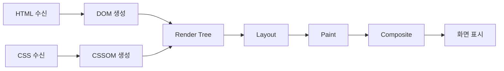

# 1주차. 브라우저 렌더링 파이프라인과 CRP

## 1. 큰 그림: 브라우저가 픽셀을 보여주기까지

CRP(Critical Rendering Path, 중요 렌더링 경로)는 브라우저가 HTML, CSS, JavaScript를 처리해 화면에 픽셀을 표시하기까지 거치는 핵심 과정이다.



- **DOM**: 문서의 내용과 계층 구조
- **CSSOM**: CSS 규칙을 브라우저가 계산에 사용할 수 있게 만든 객체 모델
- **Render Tree**: 화면에 그릴 노드와 각 노드의 계산된 스타일
- **Layout**: 각 노드의 크기와 위치 계산
- **Paint**: 텍스트, 색상, 테두리, 그림자 등을 그리기 위한 결과 생성 및 래스터화
- **Composite**: 여러 레이어를 올바른 순서와 위치로 합쳐 최종 프레임 생성

DOM은 문서의 구조일 뿐이다. DOM만 만들어졌다고 요소의 최종 크기, 위치, 색상이 정해지는 것은 아니다. CSSOM과 결합하고 Layout, Paint, Composite를 거쳐야 사용자가 보는 화면이 된다.

## 2. HTML과 CSS가 트리가 되는 과정

### HTML → DOM

HTML은 처음에는 문자열이다. 브라우저에 내장된 HTML 파서는 이를 다음과 같이 처리한다.

```text
HTML 문자열
→ 토큰화: 태그 토큰, 텍스트 토큰 등으로 분해
→ 노드 생성: Document, Element, Text 노드 등으로 변환
→ 노드를 부모·자식 관계로 연결
→ DOM
```

DOM(Document Object Model)은 HTML 문서를 JavaScript가 읽고 수정할 수 있는 구조화된 객체 모델이다.

JavaScript는 초기 렌더링이 끝난 뒤에만 DOM을 바꾸는 것이 아니다. HTML을 파싱하는 도중이나 이벤트를 처리할 때도 DOM을 변경할 수 있다. 그러면 브라우저는 변경된 내용을 반영하기 위해 필요한 Layout, Paint 등의 단계를 다시 수행한다.

### JavaScript 로딩: `defer`와 `async`

- **속성이 없는 일반 외부 스크립트**: HTML 파싱 중 `<script src="...">`를 만나면 HTML 파싱을 멈춘다. JS 파일을 다운로드하고 실행한 뒤 HTML 파싱을 재개한다.
- `defer`: HTML 파싱과 JS 파일 다운로드를 병렬로 진행하고, HTML 파싱이 끝난 뒤 JS를 실행한다. 여러 스크립트의 실행 순서를 보장한다.
- `async`: HTML 파싱과 JS 파일 다운로드를 병렬로 진행하고, 다운로드가 끝나는 즉시 JS를 실행한다. 실행하는 동안 HTML 파싱을 멈추며, 여러 스크립트의 실행 순서를 보장하지 않는다.

즉, `defer`와 `async`는 모두 JS **다운로드**가 HTML 파싱을 막지 않게 한다. 실행 시점만 다르다.

### CSS → CSSOM

CSS도 문자열이므로 파싱이 필요하다. 브라우저는 선택자와 선언을 해석해 CSSOM을 만들고, 상속·캐스케이드·우선순위를 적용해 각 요소의 최종 스타일을 계산한다.

```css
h1 {
  color: blue;
  font-size: 24px;
}
```

DOM과 CSSOM이 모두 있어야 Render Tree를 완성할 수 있다.

## 3. DOM과 CSSOM으로 Render Tree 만들기

Render Tree는 DOM과 CSSOM을 그대로 이어 붙인 트리가 아니다. 화면에 그릴 대상만 골라 각 대상에 계산된 스타일을 연결한 별도의 구조다.

### 모든 DOM 요소마다 CSSOM 전체를 처음부터 검색할까?

- 선택자를 태그, 클래스, ID 등으로 인덱싱해 후보 규칙을 빠르게 좁힌다.
- 상속되는 값을 부모의 계산 결과에서 이어받는다.
- 계산된 스타일과 이전 결과를 재사용한다.
- DOM이나 CSS가 바뀌면 전체가 아니라 영향을 받을 수 있는 범위를 무효화한다.

자료구조 관점에서 보면 **인덱스와 캐시를 함께 사용하는 방식**에 가깝다. 예를 들어 클래스 이름을 key로, 관련 CSS 규칙 목록을 value로 저장해 두면 모든 규칙을 처음부터 확인하지 않고 후보만 찾을 수 있다.

```text
"card" → [.card 규칙, .list .card 규칙, ...]
"title" → [.title 규칙, .card .title 규칙, ...]
```

즉, 트리를 순회하더라도 매번 `DOM 노드 수 × 모든 CSS 규칙 수`만큼 무조건 비교하지는 않는다.

## 4. Layout: 위치와 크기를 확정하는 단계

Layout(Reflow)은 Render Tree의 각 요소에 대해 크기와 좌표를 계산하는 과정이다. 부모의 크기가 자식에게 영향을 주고, 자식의 콘텐츠 크기가 다시 부모나 뒤따르는 형제의 위치에 영향을 줄 수 있어 파급 범위가 크다.

이 단계에서 요소의 너비, 높이, 위치 등 `offset` 정보가 확정된다. `offsetTop`처럼 속성마다 좌표의 기준은 다를 수 있다.

### 무엇이 Layout을 다시 일으키나?

- 요소 추가·삭제처럼 DOM 구조를 바꾸는 작업
- `width`, `height`, `display`, `position`, `margin`, `font-size` 등 기하에 영향을 주는 스타일 변경
- 뷰포트 크기 변경, 폰트 로드, 콘텐츠 크기 변경

### Reflow와 Layout Thrashing

강의 자료의 “DOM 읽기와 쓰기를 분리해야 한다”는 내용을 이해하려면 브라우저가 Layout을 언제 계산하는지 알아야 한다.

DOM이나 스타일을 변경해도 브라우저는 Layout을 매번 즉시 실행하지 않고, 변경 사항을 모아 다음 화면을 그리기 전에 한 번에 계산하려고 한다.

그런데 스타일을 변경한 직후 `offsetWidth`, `offsetHeight`, `getBoundingClientRect()`처럼 **현재 Layout 결과를 읽는 코드**가 나오면 최신 값을 반환해야 한다. 이때 브라우저가 미뤄 둔 Layout을 즉시 실행하는 것이 **강제 Reflow**다.

- **Reflow(Layout)**: 요소의 크기와 위치를 다시 계산하는 작업 자체
- **Layout Thrashing**: DOM 쓰기와 Layout 읽기가 반복되어 Reflow가 짧은 시간에 계속 강제되는 현상

```javascript
// 나쁜 예: 반복할 때마다 Layout 읽기와 스타일 쓰기가 교차한다.
for (const item of items) {
  const width = container.offsetWidth; // 읽기: 최신 Layout 결과가 필요함
  item.style.width = `${width}px`;      // 쓰기: Layout을 다시 변경함
}
```

첫 반복에서 너비를 읽고 스타일을 변경한다. 다음 반복에서 너비를 다시 읽으면, 방금 변경한 스타일이 반영된 최신 값이 필요하므로 Reflow가 실행될 수 있다. 이 과정이 반복되는 것이 Layout Thrashing이다.

```javascript
// 좋은 예: 필요한 값은 한 번만 읽고, 스타일 변경을 모아서 처리한다.
const width = container.offsetWidth;

for (const item of items) {
  item.style.width = `${width}px`;
}
```

`item.style.width`를 대입할 때마다 Layout이 필요한 상태가 되는 것은 맞다. 하지만 중간에 Layout 값을 읽지 않으므로 브라우저는 변경 사항을 모아 두었다가 화면을 그리기 전에 한 번에 Reflow할 수 있다.

즉, Reflow가 아예 일어나지 않는 것이 아니라 **반복문 안에서 매번 강제로 일어나지 않는 것**이다.

### CSS 스타일 계산도 트리를 도는데 왜 Layout이 특히 비쌀까?

둘 다 비쌀 수 있다. 차이는 Layout이 요소 사이의 기하학적 의존성을 풀어야 한다는 점이다.

- 부모 크기, 자식 크기, 형제 위치가 서로 영향을 준다.
- 텍스트 측정과 줄바꿈이 필요하다.
- Flex/Grid, 퍼센트, 고정·절대 위치 등 다양한 규칙을 해결해야 한다.
- 한 요소의 크기 변화가 아래쪽 요소들의 위치까지 연쇄적으로 바꿀 수 있다.

좌표만 계산해서 비싼 것이 아니라, 크기와 위치를 결정하는 상호 의존 관계와 파급 범위 때문에 비용이 커진다. 반대로 스타일 계산도 복잡한 선택자나 큰 무효화 범위를 만나면 주요 병목이 될 수 있다.

## 5. Paint: 무엇을 어떻게 그릴지 결정하기

Paint 단계에서는 Layout 결과를 바탕으로 텍스트, 배경, 테두리, 이미지, 그림자 등을 어떤 순서로 그릴지 기록하고, 이를 픽셀로 래스터화한다.

강의에서는 복잡한 그림자 효과가 Paint 비용을 높인다고 설명한다. 여기서 다음 의문이 생긴다.

> 어느 정도로 복잡한 그림자여야 비싼가? CPU로 처리하지 않을 때는 무엇이 Paint를 수행하는가?

그림자의 비용을 나누는 고정된 기준은 없다. blur 반경, 그림자가 퍼지는 면적, 요소의 크기, 화면 배율(DPR), 변경 빈도와 기기 성능이 함께 비용을 결정한다.

Paint는 크게 **그리기 명령 기록**과 **래스터화**로 나누어 볼 수 있다.

- 무엇을 어떤 순서로 그릴지 기록하는 작업은 주로 CPU가 수행한다.
- 그 명령을 실제 픽셀로 만드는 래스터화는 브라우저와 환경에 따라 CPU 또는 GPU를 사용할 수 있다.
- 만들어진 레이어를 합치는 Composite는 주로 GPU가 수행한다.

따라서 Paint 전체를 CPU 작업 또는 GPU 작업 하나로 단정할 수는 없다.

## 6. Composite: 레이어를 최종 화면으로 합치기

레이어는 Paint 결과 중 브라우저가 별도로 합성하기 위해 분리해 둔 화면 영역이다.

어떤 요소가 반드시 하나의 레이어가 되는 것은 아니다. 브라우저가 합성할 때 따로 움직이거나 처리할 필요가 있는 화면 영역을 별도 레이어로 분리한다.

Composite 단계에서는 이 레이어들을 순서에 맞게 합쳐 최종 화면을 만든다.

### Layout은 CPU, Composite는 GPU가 담당하는가?

큰 틀에서는 맞다.

- Style 계산과 Layout: 주로 메인 스레드의 CPU
- Paint 명령 기록: 주로 CPU
- Paint 결과의 래스터화: CPU 또는 GPU
- Composite: 주로 컴포지터 스레드와 GPU

따라서 Reflow가 많을 때의 직접적인 병목은 주로 CPU와 메인 스레드에서 발생한다. GPU는 이후 레이어를 합성할 때 사용된다.
