# 1주차. 브라우저 렌더링 파이프라인

## 웹페이지 렌더링 프로세스

HTML 수신 → DOM 생성 → CSS 분석 → CSSOM 생성 → 렌더 트리 생성 → 레이아웃 계산 → 페인팅 → 컴포지팅

### memo

- 렌더 트리는 화면 출력용 도면
- DOM은 구조일 뿐이다. 실제 보이는 모습은 따로 결정된다
- 자주 발생하는 렌더링 지연 원인
  - CSS와 JS 파일이 너무 많아서
  - 스크립트가 `<head>`에 위치
  - 외부 폰트나 이미지가 늦게 도착
  - 불필요한 JS 실행
  - HTTP 요청이 순차적으로 처리

## HTML 파싱과 DOM 생성

HTML은 컴퓨터에게 단순한 문자 덩어리일 뿐이다.

```html
<body>
  <h1>Hello</h1>
  <p>world</p>
</body>
```

컴퓨터는 이 텍스트만으로는 구조나 계층을 알 수 없다.
따라서 브라우저는 이 HTML 문자열을 해석하여 구조화된 데이터로 변환하는 전처리 작업을 수행한다.
이 작업의 핵심 도구가 바로 parser이다.

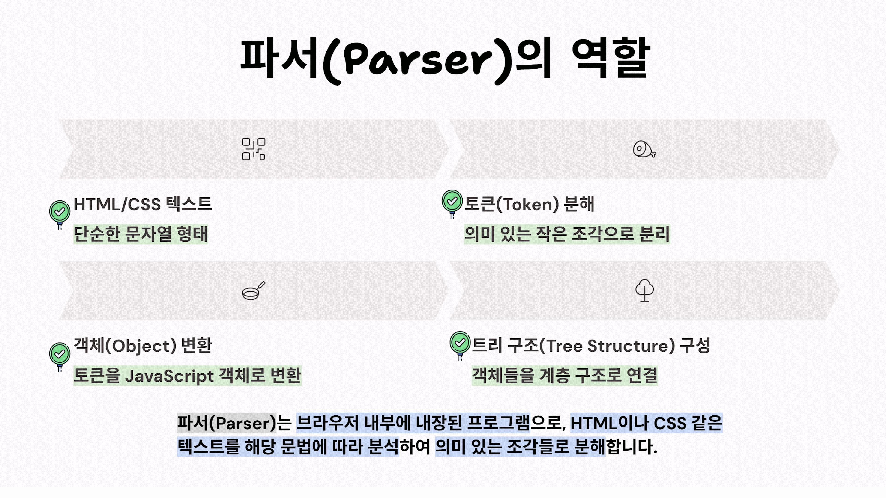

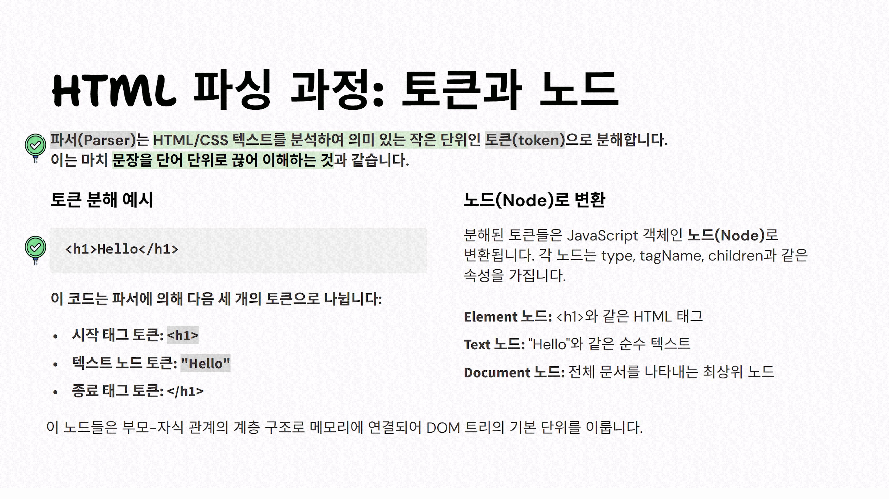

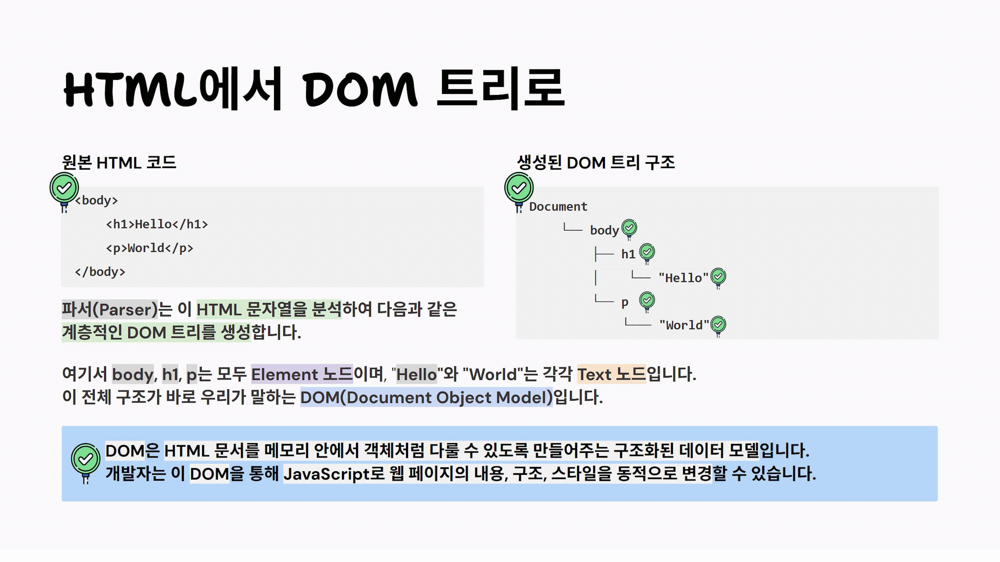

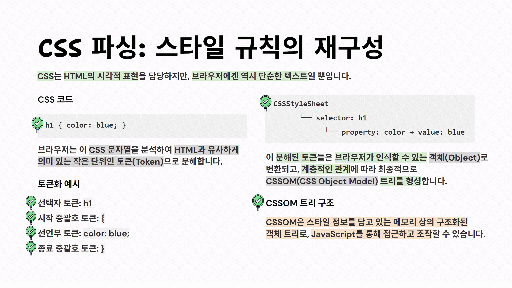

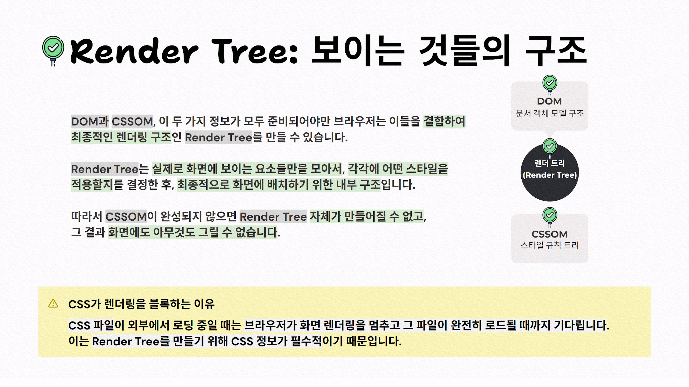

```javascript
function parseSimpleHTML(html) {
  const tagRegex = /<(\w+)>|<\/(\w+)>|([^<>]+)/g;
  // DOM 트리의 최상위 노드: Document 타입 객체를 생성한다
  // body, head 등 모든 실제 콘텐츠 노드가 이 루트 노드의 자식으로 연결
  // children 속성은 하위 노드들을 배열 형태로 저장하여 계층 구조 유지
  const root = { type: "Document", children: [] };
  // stack으로 현재 열린 태그 추적
  // 현재 열린 태그들을 stack에 저장
  // 시작 시 root만 포함
  // 열린 태그: push로 스택에 추가
  // 닫힌 태그: pop으로 스택에서 제거
  // 스택 최상단 노드가 현재 처리 중인 부모 노드
  const stack = [root];

  let match;
  while ((match = tagRegex.exec(html))) {
    if (match[1]) {
      const node = { type: "Element", tag: match[1], children: [] };
      stack[stack.length - 1].children.push(node);
      stack.push(node);
    } else if (match[2]) {
      stack.pop();
    } else if (match[3].trim()) {
      const node = { type: "Text", content: match[3].trim() };
      stack[stack.length - 1].children.push(node);
    }
  }

  return root;
}

const html = `<body><h1>Hello</h1><p>World</p></body>`;
console.log(JSON.stringify(parseSimpleHTML(html), null, 2));
```

## CSS 파싱과 CSSOM 생성

```javascript
function parseCSS(cssText) {
  const ruleRegex = /(\w+)\s*\{([^}]+)\}/g;
  const styleSheet = [];
  let match;

  while ((match = ruleRegex.exec(cssText))) {
    console.log("\n🎯 새로운 규칙 발견:");
    console.log("전체 match:", match);

    const selector = match[1];
    const declarationsBlock = match[2];

    console.log(`선택자: ${selector}`);
    console.log(`선언부: ${declarationsBlock}`);

    const declarations = declarationsBlock
      .split(";")
      .filter(Boolean)
      .map((decl) => {
        const [property, value] = decl.split(":").map((s) => s.trim());
        console.log(`  속성: ${property}, 값: ${value}`);
        return { property, value };
      });

    const rule = { selector, declarations };
    styleSheet.push(rule);

    console.log("\n📦 현재 CSSOM 트리 상태:");
    console.dir(JSON.stringify(styleSheet, null, 2));
  }

  return styleSheet;
}
```

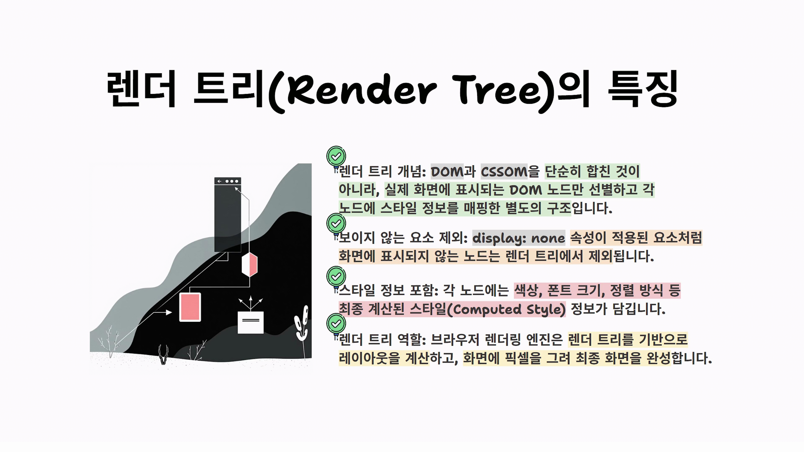

## 렌더 트리 생성

```javascript
function buildRenderTree(domNode, cssOM) {
  if (!domNode || domNode.type !== "element") return null;

  const matchedRule = cssOM.find((rule) => rule.selector === domNode.tag);
  const computedStyle = {};

  if (matchedRule) {
    matchedRule.declarations.forEach((decl) => {
      computedStyle[decl.property] = decl.value;
    });
  }

  const renderNode = {
    tag: domNode.tag,
    style: computedStyle,
    children: [],
  };

  domNode.children.forEach((child) => {
    const renderedChild = buildRenderTree(child, cssOM);
    if (renderedChild) {
      renderNode.children.push(renderedChild);
    }
  });

  return renderNode;
}

const domTree = {
  type: "element",
  tag: "div",
  children: [
    { type: "element", tag: "h1", children: [] },
    { type: "element", tag: "p", children: [] },
  ],
};

const cssOM = [
  {
    selector: "h1",
    declarations: [
      { property: "color", value: "blue" },
      { property: "font-size", value: "24px" },
    ],
  },
  {
    selector: "p",
    declarations: [{ property: "color", value: "gray" }],
  },
];

console.log("\n✅ 렌더 트리 생성 시작");
const renderTree = buildRenderTree(domTree, cssOM);
console.dir(renderTree, { depth: null });

// HTML → DOM 트리
// CSS  → CSSOM 트리

// DOM + CSSOM (필터링 + 스타일 계산)
// ↓
// Render Tree (시각적 요소만 포함된 별도 구조)
// ↓
// Layout (위치와 크기 계산)
// ↓
// Paint (픽셀 그리기)

/*
✅ 렌더 트리 생성 시작
{
  tag: 'div',
  style: {},
  children: [
    {
      tag: 'h1',
      style: { color: 'blue', 'font-size': '24px' },
      children: []
    },
    {
      tag: 'p',
      style: { color: 'gray' },
      children: []
    }
  ]
}
*/
```

## Layout → Paint → Composite

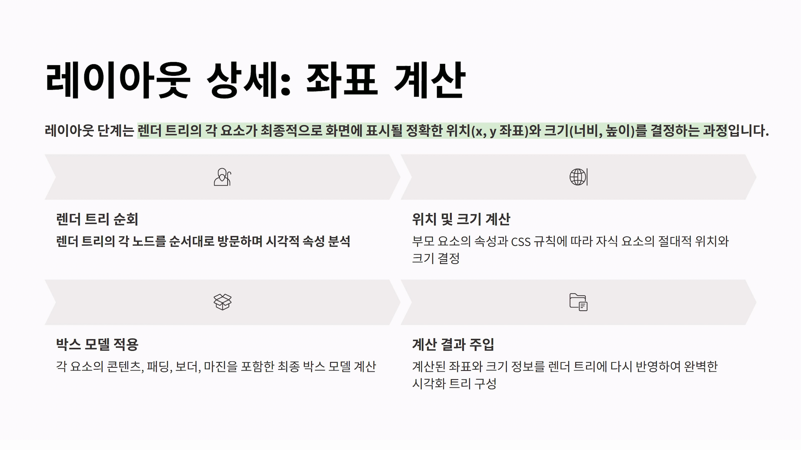

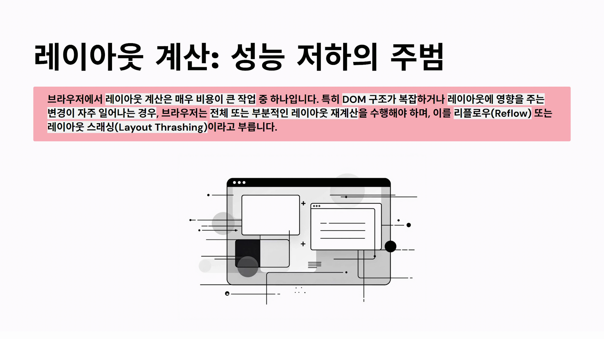

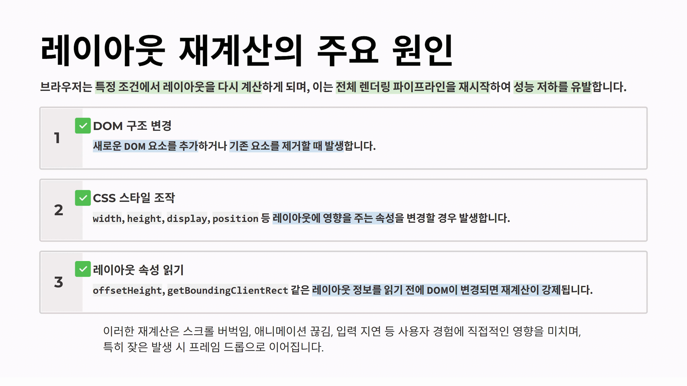

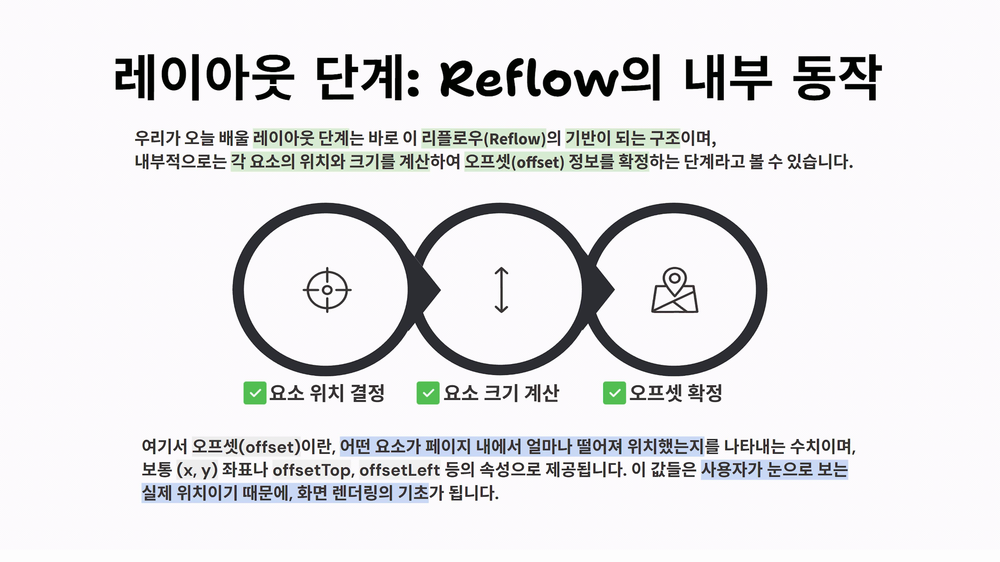

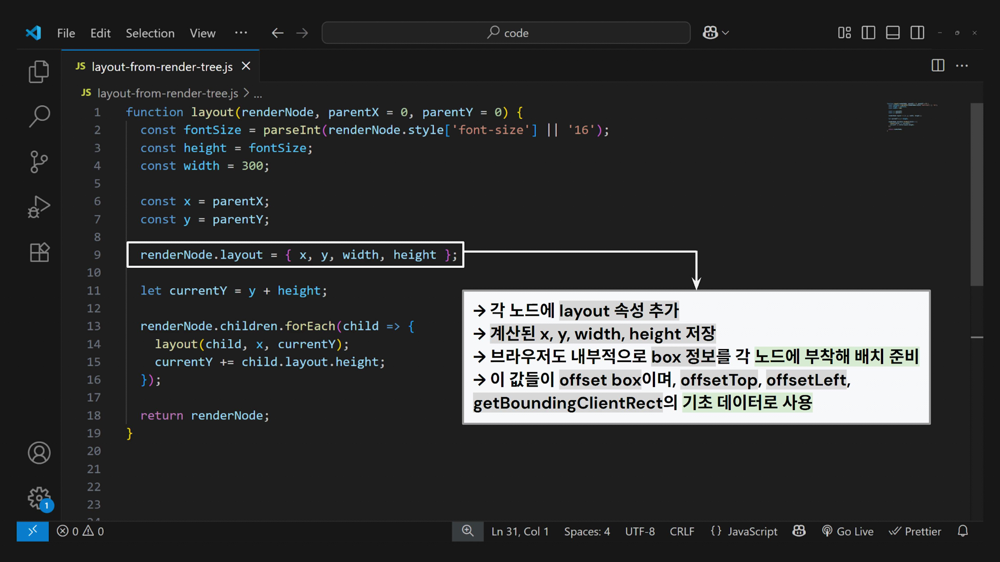

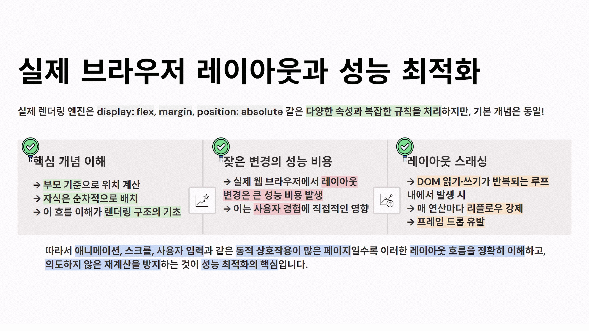

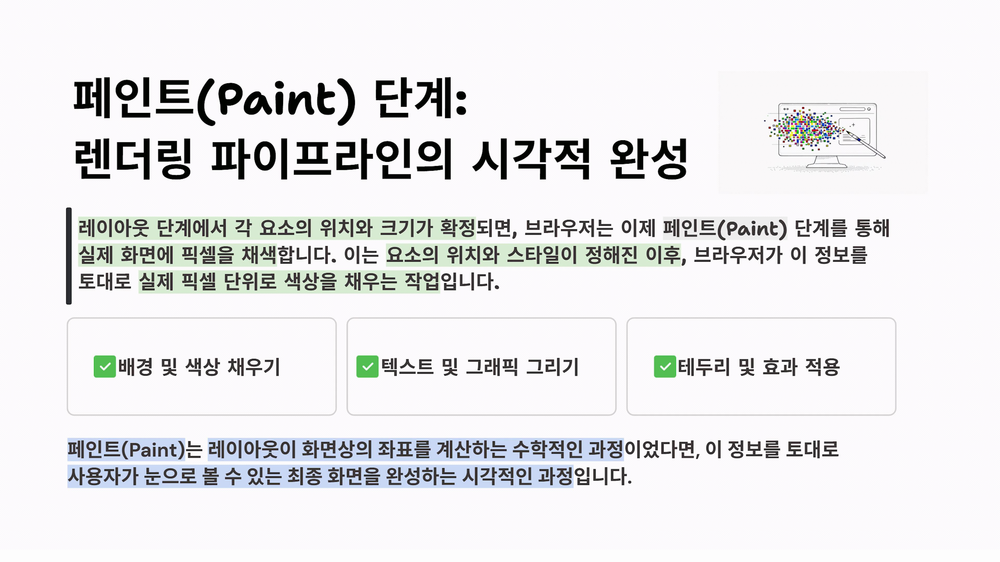

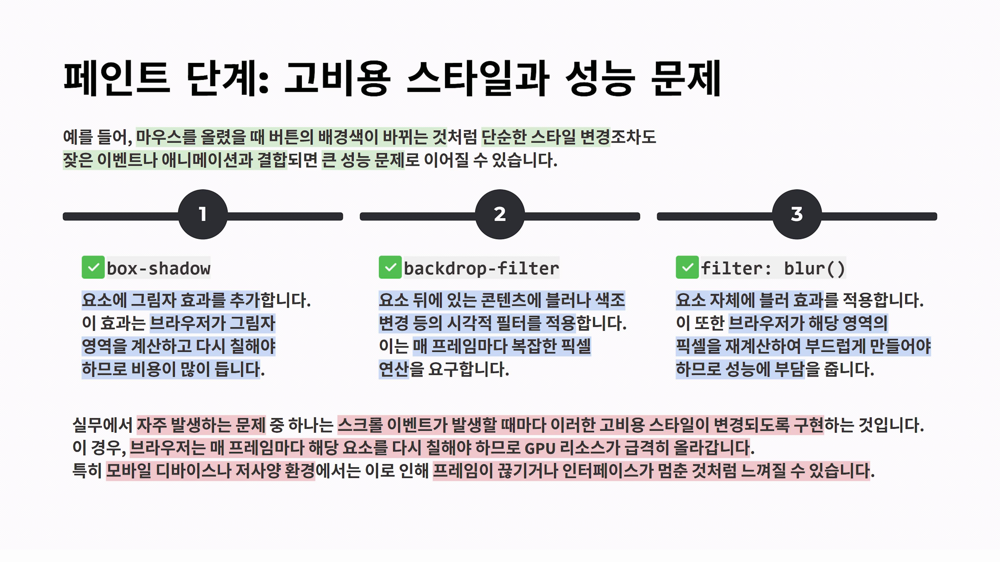

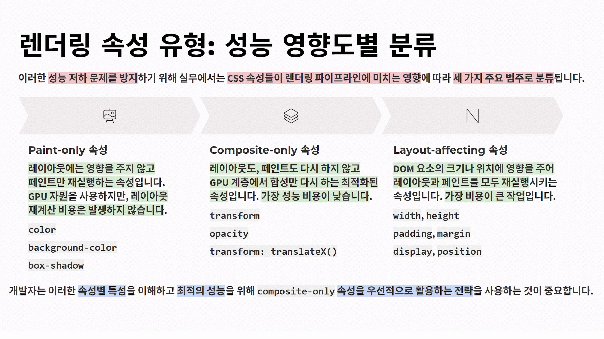

## DevTools로 확인하기

- Layers 탭: 어떤 요소가 별도 GPU 계층으로 분리되었는지 확인 가능
- Performance 탭
  - 과도한 페인트 발생 구간 분석
  - 레이아웃 반복 여부 시간대별 확인

> 실무 팁: 리플로우, 리페인트, 컴포지트 구간을 체크해 성능 병목을 점검

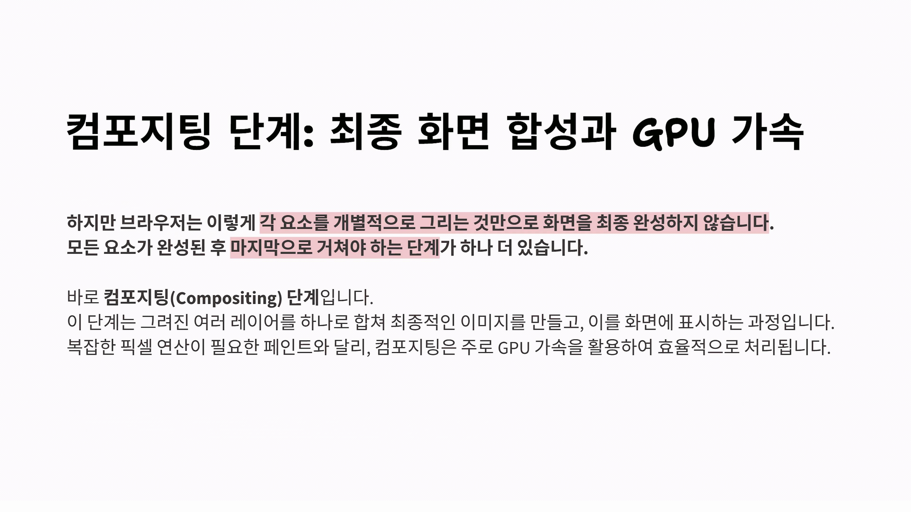

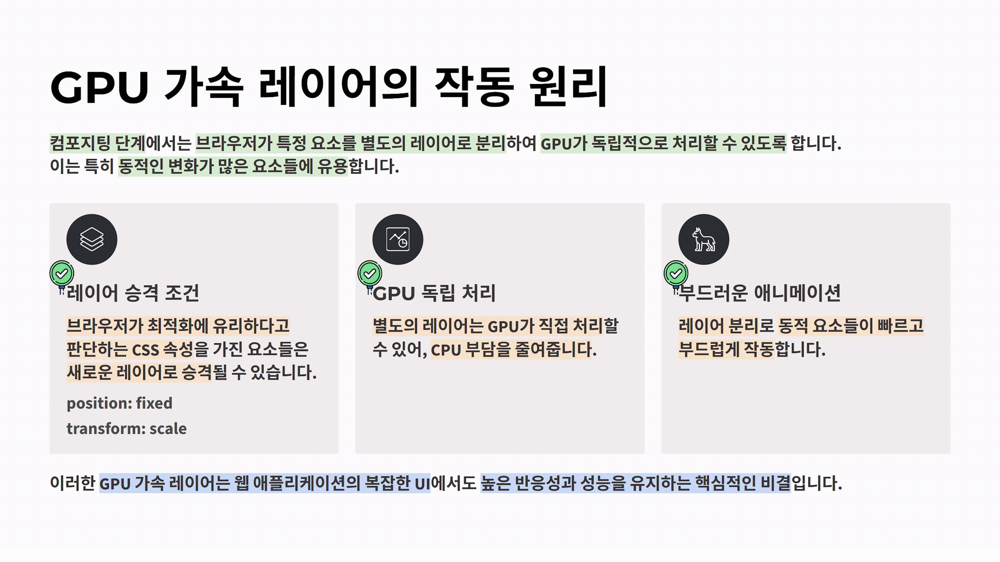

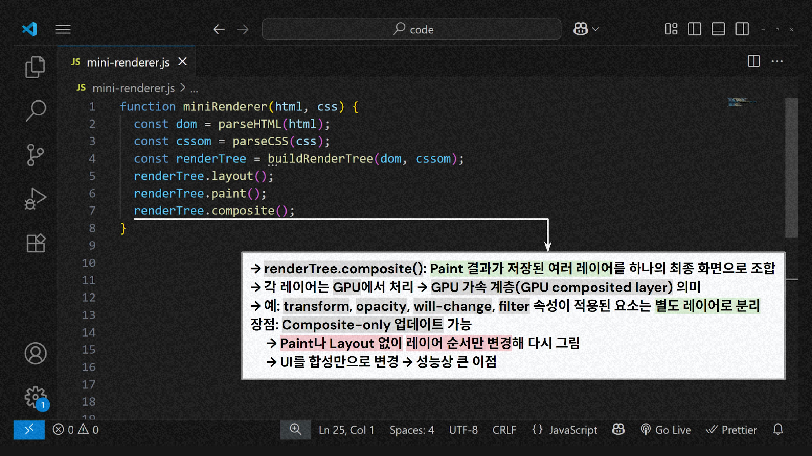
