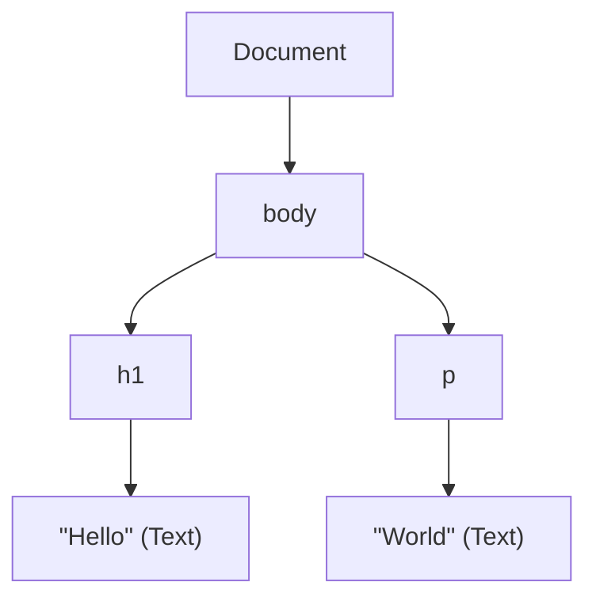
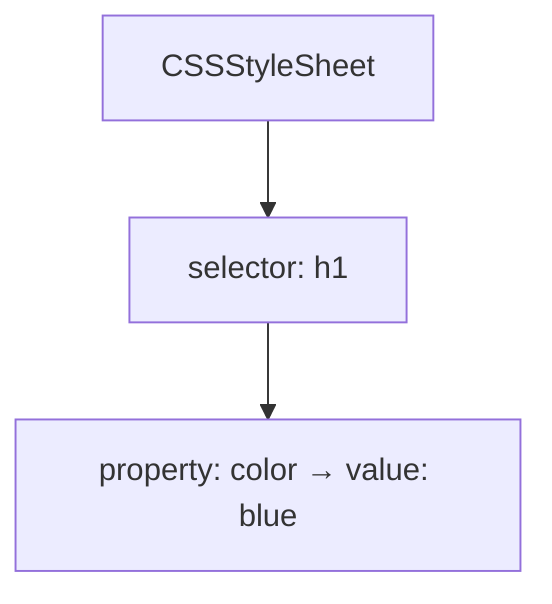
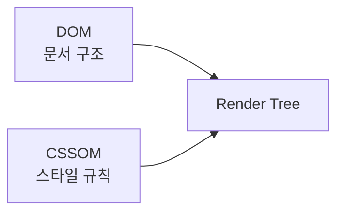
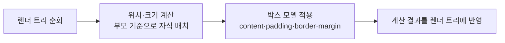
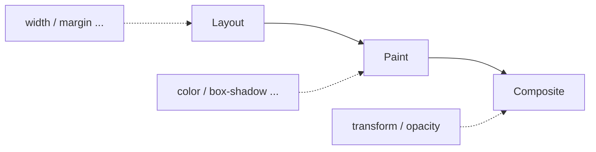

# 1주차. 브라우저 렌더링 파이프라인

## 웹페이지 렌더링 프로세스

HTML 수신 → DOM 생성 → CSS 분석 → CSSOM 생성 → 렌더 트리 생성 → 레이아웃 계산 → 페인팅 → 컴포지팅

### memo

- 렌더 트리는 화면 출력용 도면
- DOM은 구조일 뿐이다. 실제 보이는 모습은 따로 결정된다
- 자주 발생하는 렌더링 지연 원인
  - CSS와 JS 파일이 너무 많아서
  - 스크립트가 `<head>`에 위치
  - 외부 폰트나 이미지가 늦게 도착
  - 불필요한 JS 실행
  - HTTP 요청이 순차적으로 처리

## HTML 파싱과 DOM 생성

HTML은 컴퓨터에게 단순한 문자 덩어리일 뿐이다.

```html
<body>
  <h1>Hello</h1>
  <p>world</p>
</body>
```

컴퓨터는 이 텍스트만으로는 구조나 계층을 알 수 없다.
따라서 브라우저는 이 HTML 문자열을 해석하여 구조화된 데이터로 변환하는 전처리 작업을 수행한다.
이 작업의 핵심 도구가 바로 parser이다.

### 파서(Parser)의 역할

파서는 브라우저에 내장된 프로그램으로, HTML·CSS 텍스트를 문법에 따라 분석해 의미 있는 조각으로 분해한다.


### 토큰과 노드

- 토큰 분해는 문장을 단어 단위로 끊어 이해하는 것과 같다
  - `<h1>Hello</h1>` → 시작 태그 토큰 `<h1>` / 텍스트 토큰 `"Hello"` / 종료 태그 토큰 `</h1>`
- 토큰은 `type`, `tagName`, `children` 같은 속성을 가진 JS 객체인 노드로 변환된다
  - Element 노드: `<h1>` 같은 HTML 태그
  - Text 노드: `"Hello"` 같은 순수 텍스트
  - Document 노드: 전체 문서를 나타내는 최상위 노드
- 노드들이 부모-자식 관계로 메모리에 연결되어 DOM 트리의 기본 단위가 된다

### HTML → DOM 트리



- `body`, `h1`, `p`는 Element 노드, `"Hello"`, `"World"`는 Text 노드
- DOM은 HTML 문서를 메모리 안에서 객체처럼 다룰 수 있게 만든 구조화된 데이터 모델이다
- 개발자는 DOM을 통해 JS로 페이지의 내용·구조·스타일을 동적으로 바꿀 수 있다

```javascript
function parseSimpleHTML(html) {
  const tagRegex = /<(\w+)>|<\/(\w+)>|([^<>]+)/g;
  // DOM 트리의 최상위 노드: Document 타입 객체를 생성한다
  // body, head 등 모든 실제 콘텐츠 노드가 이 루트 노드의 자식으로 연결
  // children 속성은 하위 노드들을 배열 형태로 저장하여 계층 구조 유지
  const root = { type: "Document", children: [] };
  // stack으로 현재 열린 태그 추적
  // 현재 열린 태그들을 stack에 저장
  // 시작 시 root만 포함
  // 열린 태그: push로 스택에 추가
  // 닫힌 태그: pop으로 스택에서 제거
  // 스택 최상단 노드가 현재 처리 중인 부모 노드
  const stack = [root];

  let match;
  while ((match = tagRegex.exec(html))) {
    if (match[1]) {
      const node = { type: "Element", tag: match[1], children: [] };
      stack[stack.length - 1].children.push(node);
      stack.push(node);
    } else if (match[2]) {
      stack.pop();
    } else if (match[3].trim()) {
      const node = { type: "Text", content: match[3].trim() };
      stack[stack.length - 1].children.push(node);
    }
  }

  return root;
}

const html = `<body><h1>Hello</h1><p>World</p></body>`;
console.log(JSON.stringify(parseSimpleHTML(html), null, 2));
```

## CSS 파싱과 CSSOM 생성

### CSS 파싱 → CSSOM

- CSS도 브라우저에게는 단순한 텍스트라서, HTML처럼 토큰으로 분해한다
  - `h1 { color: blue; }` → 선택자 `h1` / 시작 중괄호 `{` / 선언부 `color: blue;` / 종료 중괄호 `}`
- 토큰은 객체로 변환되고 계층 관계에 따라 CSSOM(CSS Object Model) 트리를 이룬다
- CSSOM은 스타일 정보를 담은 메모리 상의 객체 트리로, JS로 접근·조작할 수 있다



```javascript
function parseCSS(cssText) {
  const ruleRegex = /(\w+)\s*\{([^}]+)\}/g;
  const styleSheet = [];
  let match;

  while ((match = ruleRegex.exec(cssText))) {
    console.log("\n🎯 새로운 규칙 발견:");
    console.log("전체 match:", match);

    const selector = match[1];
    const declarationsBlock = match[2];

    console.log(`선택자: ${selector}`);
    console.log(`선언부: ${declarationsBlock}`);

    const declarations = declarationsBlock
      .split(";")
      .filter(Boolean)
      .map((decl) => {
        const [property, value] = decl.split(":").map((s) => s.trim());
        console.log(`  속성: ${property}, 값: ${value}`);
        return { property, value };
      });

    const rule = { selector, declarations };
    styleSheet.push(rule);

    console.log("\n📦 현재 CSSOM 트리 상태:");
    console.dir(JSON.stringify(styleSheet, null, 2));
  }

  return styleSheet;
}
```

## 렌더 트리 생성

### 렌더 트리(Render Tree)



- DOM과 CSSOM이 모두 준비되어야 렌더 트리를 만들 수 있다
- DOM과 CSSOM을 단순히 합친 게 아니라, 화면에 실제로 보이는 노드만 골라 스타일을 매핑한 별도 구조다
  - `display: none`처럼 보이지 않는 노드는 제외된다
  - 각 노드에는 색상·폰트 크기·정렬 등 최종 계산된 스타일(Computed Style)이 담긴다
- 렌더링 엔진은 렌더 트리를 기반으로 레이아웃을 계산하고 픽셀을 그린다
- ⚠️ CSS가 렌더링을 블록하는 이유: CSSOM이 없으면 렌더 트리를 만들 수 없으므로, 외부 CSS를 로딩하는 동안 브라우저는 렌더링을 멈추고 기다린다

```javascript
function buildRenderTree(domNode, cssOM) {
  if (!domNode || domNode.type !== "element") return null;

  const matchedRule = cssOM.find((rule) => rule.selector === domNode.tag);
  const computedStyle = {};

  if (matchedRule) {
    matchedRule.declarations.forEach((decl) => {
      computedStyle[decl.property] = decl.value;
    });
  }

  const renderNode = {
    tag: domNode.tag,
    style: computedStyle,
    children: [],
  };

  domNode.children.forEach((child) => {
    const renderedChild = buildRenderTree(child, cssOM);
    if (renderedChild) {
      renderNode.children.push(renderedChild);
    }
  });

  return renderNode;
}

const domTree = {
  type: "element",
  tag: "div",
  children: [
    { type: "element", tag: "h1", children: [] },
    { type: "element", tag: "p", children: [] },
  ],
};

const cssOM = [
  {
    selector: "h1",
    declarations: [
      { property: "color", value: "blue" },
      { property: "font-size", value: "24px" },
    ],
  },
  {
    selector: "p",
    declarations: [{ property: "color", value: "gray" }],
  },
];

console.log("\n✅ 렌더 트리 생성 시작");
const renderTree = buildRenderTree(domTree, cssOM);
console.dir(renderTree, { depth: null });

// HTML → DOM 트리
// CSS  → CSSOM 트리

// DOM + CSSOM (필터링 + 스타일 계산)
// ↓
// Render Tree (시각적 요소만 포함된 별도 구조)
// ↓
// Layout (위치와 크기 계산)
// ↓
// Paint (픽셀 그리기)

/*
✅ 렌더 트리 생성 시작
{
  tag: 'div',
  style: {},
  children: [
    {
      tag: 'h1',
      style: { color: 'blue', 'font-size': '24px' },
      children: []
    },
    {
      tag: 'p',
      style: { color: 'gray' },
      children: []
    }
  ]
}
*/
```

## Layout → Paint → Composite

### 레이아웃(Layout)

레이아웃은 렌더 트리의 각 요소가 화면에 표시될 위치(x, y)와 크기(너비, 높이)를 정하는 단계다.



- 내부적으로는 요소 위치 결정 → 크기 계산 → 오프셋 확정 순서로, 이 구조가 리플로우(Reflow)의 기반이다
- 오프셋은 요소가 페이지에서 얼마나 떨어져 있는지 나타내는 값으로, `offsetTop`, `offsetLeft`, `getBoundingClientRect`의 기초 데이터다

```javascript
function layout(renderNode, parentX = 0, parentY = 0) {
  const fontSize = parseInt(renderNode.style["font-size"] || "16");
  const height = fontSize;
  const width = 300;

  const x = parentX;
  const y = parentY;

  // 각 노드에 계산된 x, y, width, height(box 정보)를 붙여 배치 준비
  renderNode.layout = { x, y, width, height };

  let currentY = y + height;

  renderNode.children.forEach((child) => {
    layout(child, x, currentY);
    currentY += child.layout.height;
  });

  return renderNode;
}
```

#### 레이아웃 재계산(Reflow)과 성능

레이아웃 계산은 비용이 큰 작업이다. 레이아웃에 영향을 주는 변경이 잦으면 재계산이 반복되는데, 이를 리플로우 또는 레이아웃 스래싱(Layout Thrashing)이라고 한다.

| 원인 | 예시 |
| --- | --- |
| DOM 구조 변경 | 요소 추가·제거 |
| CSS 스타일 조작 | `width`, `height`, `display`, `position` 변경 |
| 레이아웃 속성 읽기 | DOM 변경 후 `offsetHeight`, `getBoundingClientRect` 읽기 → 강제 재계산 |

- 스크롤 버벅임, 애니메이션 끊김, 입력 지연으로 이어지고, 잦으면 프레임 드롭이 생긴다
- DOM 읽기·쓰기가 반복되는 루프는 매 연산마다 리플로우를 강제한다
- 애니메이션·스크롤·입력이 많은 페이지일수록 의도하지 않은 재계산을 막는 게 최적화의 핵심이다

### 페인트(Paint)

레이아웃이 좌표를 계산하는 수학적 과정이라면, 페인트는 그 정보로 실제 픽셀에 색을 채우는 시각적 과정이다 (배경·색상 채우기, 텍스트·그래픽 그리기, 테두리·효과 적용).

- 고비용 스타일: `box-shadow`, `backdrop-filter`, `filter: blur()`는 영역 픽셀을 다시 계산해야 해서 비용이 크다
- 버튼 hover 배경색처럼 단순한 변경도 잦은 이벤트·애니메이션과 결합하면 성능 문제가 된다
- 실무에서 흔한 문제: 스크롤 이벤트마다 고비용 스타일을 바꾸면 매 프레임 다시 칠해야 해서 GPU 사용량이 급증하고, 저사양 기기에서는 프레임이 끊긴다

### 컴포지팅(Compositing)

그려진 여러 레이어를 하나로 합쳐 최종 이미지를 만들고 화면에 표시하는 단계다. 픽셀 연산이 많은 페인트와 달리 주로 GPU 가속으로 효율적으로 처리된다.

- 레이어 승격: `position: fixed`, `transform`, `opacity`, `will-change`, `filter` 등이 적용된 요소는 별도 레이어로 분리될 수 있다
- 분리된 레이어는 GPU가 직접 처리해 CPU 부담을 줄이고, 동적인 요소가 부드럽게 움직인다
- Composite-only 업데이트: Paint·Layout 없이 레이어 합성만 다시 해서 UI를 바꿀 수 있어 성능상 이점이 크다

```javascript
function miniRenderer(html, css) {
  const dom = parseHTML(html);
  const cssom = parseCSS(css);
  const renderTree = buildRenderTree(dom, cssom);
  renderTree.layout();
  renderTree.paint();
  renderTree.composite(); // Paint 결과가 담긴 여러 레이어를 하나의 화면으로 조합
}
```

### 렌더링 속성 유형: 성능 영향도별 분류

| 유형 | 다시 실행되는 단계 | 예시 속성 | 비용 |
| --- | --- | --- | --- |
| Layout-affecting | Layout → Paint → Composite | `width`, `height`, `padding`, `margin`, `display`, `position` | 가장 큼 |
| Paint-only | Paint → Composite | `color`, `background-color`, `box-shadow` | 중간 |
| Composite-only | Composite | `transform`, `opacity` | 가장 낮음 |



→ 가능하면 composite-only 속성을 우선 활용한다

## DevTools로 확인하기

- Layers 탭: 어떤 요소가 별도 GPU 계층으로 분리되었는지 확인 가능
- Performance 탭
  - 과도한 페인트 발생 구간 분석
  - 레이아웃 반복 여부 시간대별 확인

> 실무 팁: 리플로우, 리페인트, 컴포지트 구간을 체크해 성능 병목을 점검
