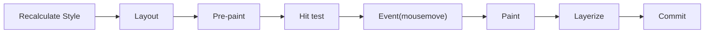
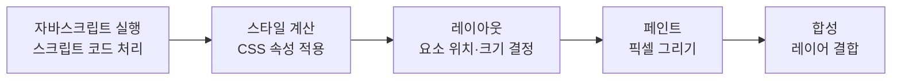

# 2주차. DevTools를 활용한 성능 진단

## Performance 탭으로 렌더링 단계 확인하기

Performance 탭에서 기록한 뒤 하단 Event log를 보면 렌더링 단계가 시간 순서대로 찍힌다.



- 여러 렌더링 단계가 매우 짧은 시간 안에 순차적으로 실행된다
- 마우스를 움직이면 `Hit test` → `Event: mouseover/mousemove` → `Pre-paint` → `Layerize` → `Commit`이 반복된다

### Layerize와 Commit

- Layerize(레이어화): 브라우저가 DOM 요소들을 GPU가 효율적으로 처리할 수 있도록 별도의 레이어로 분리하는 과정
- Composite(합성): GPU가 전달받은 여러 레이어를 실제 화면 한 장으로 조립하는 단계

> 로그에 Composite라는 이름이 보이지 않아도 Layerize와 Commit이 기록되었다면,
> 브라우저는 내부적으로 레이어를 만들고 GPU로 전달해 합성까지 마친 것이다.
> Layerize + Commit = Composite가 수행되었다는 증거

### Paint와 Composite

| 단계 | 담당 | 하는 일 |
| --- | --- | --- |
| Paint | CPU | 각 요소의 스타일을 기반으로 실제 이미지 생성 |
| Composite | GPU | Paint된 이미지를 조합해 화면 출력 |

- 레이어 기반의 복잡한 UI에서는 Composite 비용이 핵심이다
- 최적화 전략: `transform`, `opacity` 같은 composite-only 속성을 활용해 Layout·Paint를 생략하고 GPU 합성만으로 UI를 바꾼다
- 결과: 큰 성능 향상, 매끄러운 사용자 경험

## Layout Shift와 CLS

### CLS(Cumulative Layout Shift)

레이아웃 시프트(Layout Shift)는 사용자 경험 저해와 웹사이트 신뢰도 하락을 초래한다. 구글은 이를 중요한 성능 지표로 간주하고 CLS라는 수치로 평가한다.

- CLS: 웹페이지에서 발생하는 모든 예기치 않은 위치 변화의 크기를 합산한 값
- 측정 기준
  - 0.1 이하: 안정적인 사이트
  - 0.25 이상: 개선이 시급한 사이트
- 중요성: 이 수치가 검색 결과 순위에 직접적인 영향을 미칠 수 있다

### CLS 계산 방식

1. 임팩트 비율(Impact Fraction): 화면 전체 중 얼마나 넓은 영역이 흔들렸는지
2. 이동 거리 비율(Distance Fraction): 화면 기준으로 얼마나 멀리 이동했는지

- 두 값을 곱한 결과가 하나의 위치 변화 점수
- 페이지 로딩 중 여러 번 이동이 발생하면 모든 점수를 합산한 값이 CLS

```text
예시: 어떤 요소가 화면의 절반(0.5)을 차지하고, 아래로 화면의 1/4(0.25)만큼 밀림
CLS = 0.5 × 0.25 = 0.125
```

→ 화면에서 넓은 영역이 크게 움직일수록 점수가 올라가고, 사용자는 더 불안정하게 체감한다

- DevTools Performance 탭의 Live metrics에서 로컬 LCP·CLS·INP를 확인할 수 있다
- Layout shifts 탭에서 어떤 요소(예: `div.text`)가 몇 점의 시프트를 일으켰는지 볼 수 있다

### transform 속성을 활용한 애니메이션 최적화

| 방식 | 결과 |
| --- | --- |
| 일반 위치 속성(`top`, `left`, `margin`) 변경 | 전체 레이아웃 재계산(Reflow) 필요 → 성능 저하 + 화면 흔들림(Layout Shift) 발생 |
| `transform` 사용 | GPU가 직접 처리 → 레이아웃 재계산 없이 빠르고 부드러운 애니메이션 → 성능 향상 + 화면 안정성 확보 |

```html
<style>
  .box {
    width: 100px;
    height: 100px;
    background: tomato;
    transition: transform 0.3s ease;
  }

  .move {
    transform: translateX(200px);
  }
</style>

<div class="box" id="box"></div>
```

→ `left` 대신 `transform: translateX()`를 쓰면 브라우저가 전체 레이아웃을 재계산하지 않는다

## Paint·레이어 시각화

### 페인트 플래싱(Paint Flashing): 성능 문제의 시각적 신호

웹 페이지의 버벅임, 끊기는 애니메이션, 스크롤 시의 지연은 대부분 브라우저가 불필요하게 많은 요소를 다시 그리거나 업데이트하기 때문이다. HTML/CSS 코드만으로는 원인을 파악하기 어려울 때 페인트 플래싱이 해결책이 된다.

- 작동 원리: 브라우저가 화면의 요소를 다시 그릴 때마다 해당 요소의 테두리에 초록색 선을 반짝여 표시한다
- 성능 지표: 특정 요소가 계속 초록색으로 반짝인다면 그 요소가 지속적으로 리페인트되고 있다는 신호다
- 문제 진단: 해당 요소가 브라우저 성능에 부담을 주고 있으며 최적화가 필요하다는 뜻이다

### GPU 레이어 분리: 최적화와 주의사항

CSS 애니메이션 최적화의 핵심 전략 중 하나는 요소를 GPU 레이어로 분리해 렌더링 성능을 높이는 것이다. 하지만 무분별하게 사용하면 오히려 성능 저하를 초래할 수 있다.

#### 레이어 분리 유도 속성

| 속성 | 의미 |
| --- | --- |
| `transform` | 요소의 크기, 회전, 이동 |
| `opacity` | 요소의 투명도 변화 |
| `will-change` | 요소의 변화 예정을 브라우저에 미리 알림 |
| `position: fixed` | 고정 위치 요소 |

#### 과도한 레이어 분리의 위험

- 브라우저가 GPU 메모리를 과다하게 사용
- 합성(Composite) 단계에서 불필요한 오버헤드 발생
- 전반적인 렌더링 성능 저하로 이어짐

→ 결과적으로 웹 페이지의 반응성이 떨어지고 사용자 경험을 해칠 수 있다

#### 최적화 전략: `will-change`의 현명한 사용

`will-change`는 브라우저에게 이 속성이 곧 바뀔 것이라고 미리 힌트를 주는 속성이다.

- 꼭 필요한 요소에만 사용한다 → GPU 레이어를 불필요하게 늘리지 않는다
- 동적으로 적용·해제한다 → 변화가 예상될 때만 켜고, 끝나면 제거한다
- 자주 변하지 않는 요소는 굳이 미리 분리할 필요가 없다 → 오히려 메모리 낭비와 성능 저하를 유발할 수 있다

### 핵심 요약: 시각적 디버깅 도구의 활용

| 도구 | 용도 |
| --- | --- |
| 페인트 플래싱 | 브라우저가 어떤 요소를 다시 그리고 있는지 시각적으로 확인해, 불필요한 리페인트로 인한 성능 저하를 직관적으로 파악 |
| Layers 탭 | 어떤 요소가 GPU에 의해 독립적으로 렌더링되는지 분석해, GPU 메모리 사용과 합성 오버헤드를 이해하고 관리 |
| 통합 분석 | 두 도구를 조합해 겉으로 드러나지 않는 성능 병목 구간을 찾아내고, 복잡한 UI와 재사용 컴포넌트 최적화에 활용 |

> 시각적 디버깅은 코드가 아닌 화면 자체에서 성능 문제를 진단하는 능력을 길러준다.
> 새 UI를 개발하거나 기존 페이지를 리팩터링할 때 적극 활용해 성능 병목을 사전에 예방한다.

## FPS 분석

### FPS: 매끄러운 웹 경험의 핵심 지표

- 문제 상황: 스크롤이 끊기거나 애니메이션이 부자연스러움 → 브라우저가 화면을 충분히 빠르게 그리지 못하고 있음
- FPS(Frames Per Second): 브라우저가 1초에 화면을 몇 번 업데이트하는지 나타내는 지표
  - FPS가 높을수록 → 부드러운 화면 전환
  - FPS가 낮아지면 → 버벅임·끊김

### FPS 저하의 원인: 16.67ms

FPS가 떨어지는 가장 큰 이유는 브라우저가 한 프레임을 그리는 데 너무 오래 걸리기 때문이다. 60fps를 유지하려면 브라우저는 16.67ms마다 한 번씩 화면을 그려야 하고, 이 시간 안에 아래 단계를 모두 마쳐야 한다.



→ 이 중 어느 한 과정에서라도 16.67ms의 시간 예산을 넘기면 해당 프레임은 늦게 그려지거나 건너뛰어지고, 사용자는 버벅인다고 느낀다

### 렌더링 최적화 예시

아이템 1000개를 그리는 페이지에서 렌더링 비용을 줄이는 방법이다.

```html
<style>
  .item {
    width: 100px;
    height: 100px;
    margin: 10px;
    display: inline-block;
    background: radial-gradient(circle, #f28b82, #c62828);
    filter: drop-shadow(0 0 6px rgba(0, 0, 0, 0.4));
    border-radius: 50%;
    will-change: transform;
    transition: transform 0.3s ease;
  }

  .item:hover {
    transform: scale(1.2) rotate(10deg);
  }
</style>

<div id="container"></div>

<script>
  const container = document.getElementById("container");

  for (let i = 0; i < 1000; i++) {
    const div = document.createElement("div");
    div.className = "item";
    container.appendChild(div);
  }
</script>
```

| 변경 | 효과 |
| --- | --- |
| `box-shadow` → `filter: drop-shadow` | GPU 가속 활용 |
| `opacity` 제거 | Paint 재계산 회피 |
| `transform`만 사용 | Composite 단계에서만 처리 |
| `will-change: transform` 적용 | 사전 레이어 준비 힌트 |
| `background-color` → `radial-gradient` | 시각적 풍부함 유지, 스타일 계산 비용 증가 없음 |
